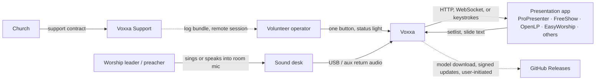
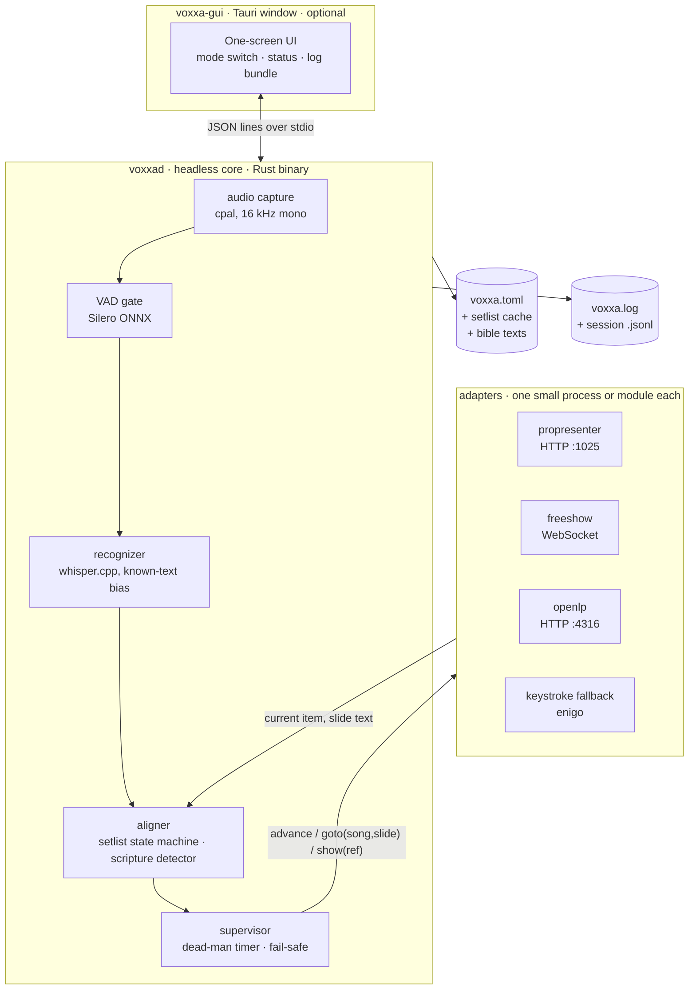

# Voxxa — Software Strategy and Design

Status: Proposed for user review · Date: 2026-10-24 · Owner: nategroks · Phase: 10x-Team Phase 2 (Principal Architect + Staff Engineer)
Evidence: `2026-10-24-research-report.md` (A1…E8). Decisions: ADR-001…009 in `.10x/adrs/`. Business context: `2026-10-24-business-strategy.md`.

## 1. Recommendation (one paragraph)

Rebuild the pipeline around **position tracking against known text**, not transcription (E2, E3, ADR-009): the recognizer becomes a replaceable component behind a trait (ADR-004), the aligner becomes a song-structure state machine with an evidence accumulator and a fail-safe supervisor, and every decision is measured by advance precision and latency on a recorded corpus before a volunteer ever sees it. Split the app into a headless core and a thin GUI (ADR-001) with one TOML file and a JSON-lines protocol (ADR-003), so a support bundle reproduces any Sunday in CI. Integrate through native local APIs where they exist (ProPresenter 7.9+, FreeShow, OpenLP; ADR-006) and keystrokes where they do not, never through SongSelect (ADR-007). Ship Windows first as a signed installer plus a Microsoft Store listing, then notarized macOS, then an AppImage built on Ubuntu 22.04 (ADR-002, ADR-008). Hold the whole thing to a suckless budget: core under 3,000 lines of Rust, each adapter under 300, zero frontend dependencies, one `cargo test`.

## 2. Assumptions and open questions

Assumptions (proceeding on these; the user research plan tests them):
- A desk feed (USB interface or aux return) is available in most booths; ambient mic is the fallback, not the default.
- Volunteers accept a late advance; they do not accept a wrong one. False-advance budget: < 1 per 10-song set.
- The launch church runs Windows and one of ProPresenter 7.9+, FreeShow or OpenLP.
- A 4-core laptop CPU without a usable GPU is the floor hardware.

Open until measured: which recognizer wins on sung vocals (ADR-004 bake-off); whether whisper `initial_prompt` biasing helps or hallucinates on this corpus (E6); ProPresenter API behaviour on current 7.x builds (A1 gap); whether scripture mode is launch scope (research O6).

## Quality attributes, ranked

Stack-rank forced by the business outcome ("a volunteer presses one button and the slides follow the room"). Two attributes deliberately sacrificed: throughput (one room, one mic) and multi-tenancy (none).

| Rank | Attribute | Scenario (stimulus / environment / response / measure) | Tactics | What we spend |
|---|---|---|---|---|
| 1 | **Correctness of advance** | Worship leader sings the first words of the next slide, live band mix, reverberant 300-seat room, mic feed from the desk aux. Voxxa advances exactly once. Measure: ≥ 95% of slide transitions within 1.5 s of the first sung word of the new slide; **false advances < 1 per 10-song set**; never skips two slides. | Known-text decoding (bias recognizer toward setlist text), per-song local search window (current ±2 slides), hysteresis margin, VAD, confidence gate before sending a command. | Latency (we wait for evidence), CPU for a larger model, engineering time on an evaluation corpus. |
| 2 | **Operability by a non-technical volunteer** | Volunteer opens the app 10 min before service. Response: one screen, one big button, one status light. Measure: first-service setup ≤ 10 min with the quick-start card and no phone call; zero settings required to reach "Following". | Three-position mode switch, auto-detect presentation app, config in one TOML file, "Call for help" button that bundles logs. | Flexibility (advanced knobs hidden behind a text file). |
| 3 | **Fail-safe** | Recognizer stalls, mic unplugged, presentation app loses focus. Response: Voxxa stops sending commands and shows red; the human operator continues manually with zero extra steps. Measure: no command sent after the last good transcript is older than 8 s; operator override wins within 100 ms. | Watchdog, dead-man timer, manual keys always pass through, adapter reports delivery failure. | A few hundred lines of supervision code and tests. |
| 4 | **Privacy / local-first** | Service audio contains prayer requests and pastoral content. Response: audio never leaves the machine. Measure: zero outbound network calls during a service (verified by a test that runs with networking disabled); the only outbound traffic ever is model download and update check, both user-initiated or visibly announced. | On-device Whisper, no telemetry by default, update check opt-in. | We cannot use cloud ASR, which would be more accurate. Accepted: this is the trust story. |
| 5 | **Maintainability by a 1–2 person team** | A church reports "stopped advancing on ProPresenter 7.18". Response: fix shipped in a point release in < 1 week. Measure: core engine ≤ 3k LOC Rust, each adapter ≤ 300 LOC, every adapter has a recorded-traffic contract test; one `cargo test` runs everything. | Unix decomposition (small processes, text protocols), adapters as isolated crates, replay fixtures, no framework on the frontend. | Features we will not build (cloud sync, media, lyrics editing). |
| 6 | **Install friction** | Volunteer downloads on a church Windows 11 PC with no admin rights. Response: double-click, no SmartScreen red screen, no "install WebView2" detour. Measure: signed installer; install ≤ 2 min; per-user install works without admin. | Authenticode signing (Azure Trusted Signing or SignPath), NSIS per-user mode, bundled WebView2 bootstrapper, winget manifest. | Signing cost and yearly identity paperwork. |
| 7 | **Latency** | See rank 1. Measure: end-to-end (first word → key sent) p50 ≤ 1.2 s, p95 ≤ 2.5 s on a 4-core laptop CPU with the default model. | Streaming 1 s hops with 5 s rolling window, smaller model, VAD. | Accuracy if model too small; tuned per machine class. |
| 8 | **Portability (Win → macOS → Linux)** | Same TOML config and same core binary behaviour on all three. Measure: one CI matrix, one test suite, platform-specific code confined to audio capture, key injection and installer. | Rust std + cpal + enigo already abstract this; adapters are network protocols, platform-neutral. | Must resist platform-specific "quick wins" in the core. |

Collisions we accept:

```
If we optimize correctness by waiting for more evidence, we spend latency.
We accept this because a late advance is forgivable in worship; a wrong advance is not.
We will revisit when the evaluation corpus shows p95 latency > 2.5 s on the default model.

If we optimize operability by hiding knobs, we spend flexibility for power users.
We accept this because power users can edit voxxa.toml; volunteers cannot.
We will revisit if > 20% of support tickets are "where is the setting for…".
```

## C4 — L1 Context



## C4 — L2 Containers (one machine, one process tree)



Trust boundary: everything above is one user account on one machine. The only network paths are adapter traffic to the presentation app (same machine or LAN) and user-initiated downloads from GitHub.

## Unix decomposition (what "suckless" means here)

| Process / module | One job | Input → output | Config |
|---|---|---|---|
| `voxxad` | Listen and decide | audio device → JSON lines on stdout (`{"event":"advance","song":3,"slide":2,"conf":0.91}`) | `voxxa.toml` |
| `voxxa-adapter-*` | Deliver a decision to one presentation app | JSON lines on stdin → HTTP/WS/keystroke | section in `voxxa.toml` |
| `voxxa-setlist` | Get today's setlist from the presentation app or Planning Center into the canonical JSON | app API → `setlist.json` | same file |
| `voxxa-eval` | Score the aligner against recorded services | `.wav` + `setlist.json` + ground truth → metrics table | none |
| `voxxa-gui` | Show status and the one button | JSON lines ↔ `voxxad` | none (writes `voxxa.toml`) |

Rules: plain text protocols, one config file, no daemon unless the GUI is open, `voxxad --stdin-audio` lets everything be tested without a microphone. The GUI is a convenience over the CLI, never the other way round. A church that wants to script Voxxa from Bitfocus Companion or a Stream Deck can, because the CLI is the product.

## Recognition and alignment design (the hard problem; ADR-004, ADR-009)

### Why the current loop is the wrong shape
Today: 5 s of audio → Whisper → text → character-LCS partial ratio against current and next slide → Right Arrow. Whisper deletes and hallucinates on sung vocals (WER 21–56%, E2), the 5 s batch adds up to 5 s of latency, the LCS over 40 words × slide text is O(n·m) per slide per update, and linear "next slide only" cannot follow a repeated chorus. None of it is measured.

### Target pipeline (all inside `voxxad`)

```
audio 16 kHz mono ──► Silero VAD (gate + 200 ms pad) ──► Recognizer (trait)
                                                              │ hypotheses: words + timestamps + confidence, every ~1 s hop
                                                              ▼
setlist.json ──► SongGraph (songs → sections → slides) ──► Aligner: scores each *candidate position*
                                                              │ evidence accumulator with decay; hysteresis
                                                              ▼
                                                        Supervisor: min dwell, dead-man timer, adapter health
                                                              │ advance / goto / show_ref / status
                                                              ▼
                                                        Adapter (trait) ──► presentation app
```

- **Recognizer trait**: `fn feed(&mut self, pcm: &[f32]) -> Vec<Hypothesis>`; implementations: `whisper_cpp` (today's whisper-rs, streaming windows of 5 s with 1 s hop, `single_segment`, `initial_prompt` = text of the current and next two slides, ≤ 224 tokens, `carry_initial_prompt`), `sherpa_onnx` (streaming Zipformer, true streaming, hotword biasing to be verified), `moonshine` (streaming tiny). Chosen by `[recognizer] engine = "..."` in `voxxa.toml`; default decided by the Increment 5 bake-off.
- **SongGraph**: candidate positions are slides; allowed transitions from slide *i*: stay, *i+1* (prior 0.6), start of any section in the same song (chorus/bridge repeat, prior 0.25 shared), first slide of the next song (0.1), anything else (0.05). Priors are config, not code.
- **Aligner**: for each candidate, token-level similarity of the last ~12 recognized words against the candidate's first ~12 words and the previous slide's last words (so a late catch still lands), using the existing LCS ratio on *word tokens* (not characters) after normalisation (lowercase, strip punctuation, number words). Evidence per candidate = exponentially decayed sum of per-hop scores. Decision: advance when the best candidate ≠ current, its evidence ≥ `threshold` and ≥ current + `margin`, and dwell since the last decision ≥ `min_dwell_ms` (default 2,500). One decision per hop, never two.
- **Supervisor**: no hypothesis for 8 s → status amber, no commands; adapter error or `current()` disagrees with internal position for two consecutive reads → re-sync from the adapter (adapters that can read) or red (adapters that cannot); manual key events observed from the adapter → accept and re-sync, never fight the operator.
- **Scripture detector** (same accumulator, different graph): a spoken-reference grammar (`<book> <chapter> [verse|:] <verse>`, with "first/second/third", "chapter", "verse", ordinal and cardinal number words) emits a candidate reference; confirmation requires ≥ 5 of the next 7 words to match the PD text of that verse; then `show_ref`; subsequent verses follow by the same alignment against the chapter text.

### Measurement is part of the design
`voxxa-eval` consumes `(audio.wav, setlist.json, truth.jsonl)` where truth is the operator's actual slide-change timestamps, and reports: advance precision, recall, median and p95 latency (first sung word of the new slide → decision), false advances per set, and missed sections. It runs in CI on three fixture services (two synthetic from PD hymns with TTS/sung recordings the founder makes, one donated real service when consented) and on the pilot corpus when it exists. **A change that lowers precision on the corpus does not merge.** This harness is the single most valuable artefact in the plan; it is also what lets Claude Code work unattended on the aligner.

## Adapter strategy (ADR-006)

| Tier | App | Drive | Read current slide text | Setlist import | Transport | Evidence |
|---|---|---|---|---|---|---|
| 1 | ProPresenter 7.9+ | `POST /v1/trigger/next`, `/v1/presentation/{uuid}/trigger/{index}` | `/v1/status/slide` (current + next), `/v1/status/updates` stream | `/v1/playlist/current`, `/v1/presentation/{uuid}` | HTTP, LAN, port discovered (1025 example), network toggle | A1 |
| 1 | FreeShow | `next_slide`, `index_select_slide`, `start_scripture {reference}` | `get_output_slide_text`, `get_slide` | `get_show`, `get_projects` | REST :5506 / WS :5505, optional bearer | A2 |
| 1 | OpenLP | `POST /api/v2/controller/progress`, `/show`, `/api/v2/plugins/bibles/…` | `GET /api/v2/controller/live-items` (per-slide text) | `GET /api/v2/service/items` | HTTP :4316 + WS :4317, optional token | A3 |
| 1 | Holyrics | `ActionNext`, `ActionGoToIndex`, `ShowVerse` | `GetCurrentPresentation` | `GetCurrentSchedule`, `GetLyrics` | HTTP, token | A5 |
| 2 | Proclaim | `appCommand/perform` (next/prev/goto) | on-air status only | none | HTTP :52195, password → token | A5 |
| 2 | EasyWorship | MIDI (rtpMIDI) or hotkeys Down/Up; Companion protocol undocumented | none | none | MIDI / keystroke | A4 |
| 2 | WorshipTools Presenter | MIDI in; keystrokes | none | none | MIDI / keystroke | A4 |
| 3 | MediaShout, VideoPsalm, SongBeamer, others | keystrokes (F9/F7, Down, Right) | none | file export | enigo | A4 |

Rules: an adapter is ≤ 300 LOC, exposes `advance`, `prev`, `goto(song, slide)`, `show_ref`, `current()`, `setlist()` with capability flags, and ships with a recorded-traffic contract test (fixtures captured once against the real app). Discovery probes localhost ports first, then the configured host; it confirms identity via the app's version endpoint before sending anything. Tier 2/3 adapters run in "blind" mode: Voxxa trusts its own position and the status light says so. MIDI as a universal fallback (loopMIDI / IAC) is deferred until a church asks.

## Setlist and text sources (ADR-007)

Priority order, first one that works wins: (1) the adapter's own playlist (already licensed, already the truth); (2) Planning Center Services API (plans → items → songs → arrangements → lyrics; personal access token; many churches already pull SongSelect lyrics into it); (3) a file: Voxxa `setlist.json`, OpenSong/OpenLyrics XML, ChordPro/plain text with blank-line slide breaks; (4) a small bundled public-domain hymn index for churches on Tier 3 apps with no export. Voxxa never fetches from SongSelect and never ships copyrighted lyrics. `usage.csv` records title, CCLI number if present, date, for the church's own reporting.

Bibles: WEB, KJV, ASV, BSB bundled as compressed plain text (public domain, B6) for *matching only*; the displayed translation is whatever the presentation app shows. Paraphrase translations (NLT, The Message) lower matching confidence; the spoken reference carries the decision in that case.

## Simple mode — the whole UI for a volunteer

One window, three things:

1. **Mode switch (three positions):** `Off` · `Songs` · `Songs + Scripture`.
2. **Status light:** grey (not listening) · amber (listening, nothing matched yet) · green (following, shows "Song 3 · slide 2/6") · red (lost, with one line: "Can't hear the mic" / "ProPresenter not found" / "Lyrics don't match what I hear").
3. **One button:** `Call for help` → zips `voxxa.log`, the current `voxxa.toml`, the last 2 minutes of transcript (no audio), and opens the support e-mail / portal with it attached. This is the support contract's intake path.

Everything else lives in `voxxa.toml`, documented inline, editable from an "Advanced…" link that opens the file in the OS text editor. Sliders (threshold, margin) move out of the window: they are tuned once per room by support or by the auto-calibration step, not during a service.

First run (≤ 10 min): choose mic (default pre-selected if a USB desk interface is present) → Voxxa finds the presentation app on localhost/LAN or falls back to keystrokes and says so → downloads the default model with a progress bar → "Play 20 seconds of any song to test" → green.

## Scripture behaviour (`Songs + Scripture` mode)

- The preacher says "turn with me to Romans 8, verse 28". Voxxa's reference parser hears `Romans 8:28` with confidence, waits for the first 5–7 words of the verse to confirm, then issues `show(ref)` to the adapter. In ProPresenter that triggers the Bible look; in FreeShow/OpenLP the scripture item; in keystroke fallback it does nothing and shows the reference on the status line for the operator to type.
- As the preacher reads on, Voxxa follows verse boundaries the same way it follows slides.
- Translation: whatever the church's presentation app is set to; Voxxa only needs any one text of the passage for matching, and ships public-domain texts (WEB, KJV, ASV) for that purpose. Display rights stay with the presentation app and the church's licence.

## Songs: CCLI vs public domain

- Lyrics for matching come from the presentation app's own library (already licensed by the church) via the adapter, or from the exported setlist file. Voxxa never redistributes copyrighted lyrics and never shows them on the projector; it only reads them locally to find position.
- Public-domain hymns: Voxxa may ship a small PD hymn index for churches whose software has no API (fallback mode), clearly tagged PD.
- Voxxa writes a local `usage.csv` (song title, CCLI number if present, date) that a church can paste into their CCLI report. Reporting stays the church's act, not Voxxa's.

### `voxxa.toml` (every key has a commented default; the GUI writes only the first block)

```toml
mode = "songs"              # off | songs | songs+scripture
audio_device = "default"    # name from `voxxad --list-devices`
adapter = "propresenter"    # propresenter | freeshow | openlp | holyrics | proclaim | keystroke

[adapter.propresenter]
host = "127.0.0.1"
port = 1025                 # see ProPresenter > Settings > Network

[recognizer]
engine = "whisper_cpp"      # whisper_cpp | sherpa_onnx | moonshine
model = "base.en"
hop_ms = 1000
window_ms = 5000

[aligner]
threshold = 0.70
margin = 0.10
min_dwell_ms = 2500
priors = { next = 0.6, section_start = 0.25, next_song = 0.1, other = 0.05 }

[scripture]
match_text = "web"          # web | kjv | asv | bsb (matching only; display is the app's)

[support]
log_days = 14
```

## Maintenance model ("easily maintained" made measurable)

| Budget | Limit | Enforced by |
|---|---|---|
| Core (`voxxad` without adapters) | ≤ 3,000 LOC Rust | `tokei` check in CI |
| Each adapter | ≤ 300 LOC + fixture | CI |
| GUI | ≤ 800 LOC JS/HTML/CSS, zero npm runtime deps | CI |
| Direct Rust dependencies | ≤ 25 crates | `cargo tree --depth 1 | wc -l` in CI |
| Binary size (no models) | ≤ 30 MB Windows | release job asserts |
| Cold start to "Listening" | ≤ 2 s after model load | eval harness |

Practices: one `cargo test` runs unit tests, replay fixtures and adapter contract tests; `voxxa-eval` runs on every PR against the fixture corpus and blocks regressions; `cargo fmt --check`, `clippy -D warnings`, `cargo deny` (licences and advisories) on every PR; Renovate monthly, security advisories immediate; **release train**: community point release monthly, support channel two weeks later, never Friday–Sunday; models pinned by SHA-256 in code; protocol `"v"` field and `voxxa.toml` keys are append-only; every bug report must arrive as a "Call for help" bundle or be reproduced into one before it is worked. Delete, do not deprecate: the `mcp` module and `tauri-plugin-store` go now (ponytail rung 1; ADR-003).

## Security and privacy (STRIDE-lite on the two trust boundaries)

| Boundary | Threat | Control |
|---|---|---|
| Microphone → `voxxad` | Pastoral content leaks (information disclosure) | Audio never written to disk except the opt-in eval recording the user starts; transcript ring buffer of 2 min only; no network listener in Voxxa; outbound only to the configured adapter host and, user-initiated, GitHub. A CI test runs a full replay with networking disabled and asserts zero sockets opened. |
| `voxxad` → presentation app (LAN) | Commands sent to the wrong machine (tampering); credential exposure | Adapter binds to the configured host only, confirms identity via the app's version endpoint, stores tokens in the OS keychain (`keyring` crate) not in TOML. |
| Update channel | Forced downgrade via unsigned manifest (CVE-2026-95625 class, D6) | minisign on artefacts (already), client refuses any version lower than installed, manifest pinned to the release tag, private key stored offline with two holders. |
| Keystroke fallback | Keys sent to the wrong window | Fallback only sends when the adapter's target process is foreground (platform check); otherwise status red and no send. |
| Support bundle | Over-collection | Bundle = `voxxa.toml` (tokens redacted), `voxxa.log`, last 2 min transcript, versions; shown to the user before sending; no audio. |

CSP is currently `null`; set a strict CSP since the GUI loads no remote content.

## Operability minimum before any church sees it

- Pipeline with rollback: tagged release → signed artefacts → `latest.json`; rollback = re-point `latest.json` to the previous tag (client version-monotonicity means a rollback is published as a new patch version).
- Signals on the critical journey: per-service `session-*.jsonl` with every hypothesis, score and decision; `voxxad --replay` reproduces it.
- Alert that pages a human: the church's "Call for help" button; for support-tier churches, the Sunday hotline window.
- Backup and restore: `voxxa.toml` + `setlist.json` are the whole state; documented copy/restore; tested once in the quick-start.
- Secrets: adapter tokens in the OS keychain; updater key offline.
- Owners: core, adapters, GUI, release each have a named owner (today: the founder for all; the point is the list).
- Runbooks for the top three dependencies being down: no audio device, presentation app not reachable, model file missing/corrupt. Each runbook fits on one screen and is linked from the red status line.

## Platform sequence (ADR-002) — specifics that differ per platform

| | Windows (launch) | macOS (second) | Linux AppImage (third) |
|---|---|---|---|
| Installer | NSIS per-user + MSI; WebView2 evergreen bootstrapper; winget manifest; Store MSIX | notarized DMG; Homebrew cask (must pass Gatekeeper, D5) | AppImage built on Ubuntu 22.04 with webkit2gtk 4.1 (D6); `.deb` by-product; zsync update info embedded |
| Audio | WASAPI via cpal; desk USB interface = normal input | CoreAudio via cpal; mic permission prompt | ALSA/PulseAudio/PipeWire via cpal |
| Keystroke fallback | SendInput via enigo | needs Accessibility permission; GUI guides the user | X11 via libxdo; Wayland: unavailable, network adapters only |
| Known pitfalls | SmartScreen until reputation (D3) → Store listing; antivirus false positives on unsigned builds | notarization queue; Sequoia removed right-click Open bypass | WebKitGTK graphics crashes → ship documented env-var workarounds (D6) |

## Suckless scorecard for this design (ponytail ladder applied)

- Rung 1 (does it need to exist?): removed `mcp` module, `tauri-plugin-store`, GUI sliders, cloud sync, lyrics editing, media handling, remote/phone control, MIDI (deferred).
- Rung 2 (already here?): keep cpal, whisper-rs, enigo, tokio, serde, the hand-rolled LCS (E8 shows no crate replaces it), the existing CI matrix and updater key.
- Rung 3 (std/platform?): OS keychain for tokens; OS config dirs; plain files instead of a database.
- Rung 4 (installed dep?): Tauri's shell plugin spawns `voxxad`; no new IPC framework.
- Rung 6 (minimum that works): one adapter trait, one recognizer trait, one config file, one protocol, one eval harness.
